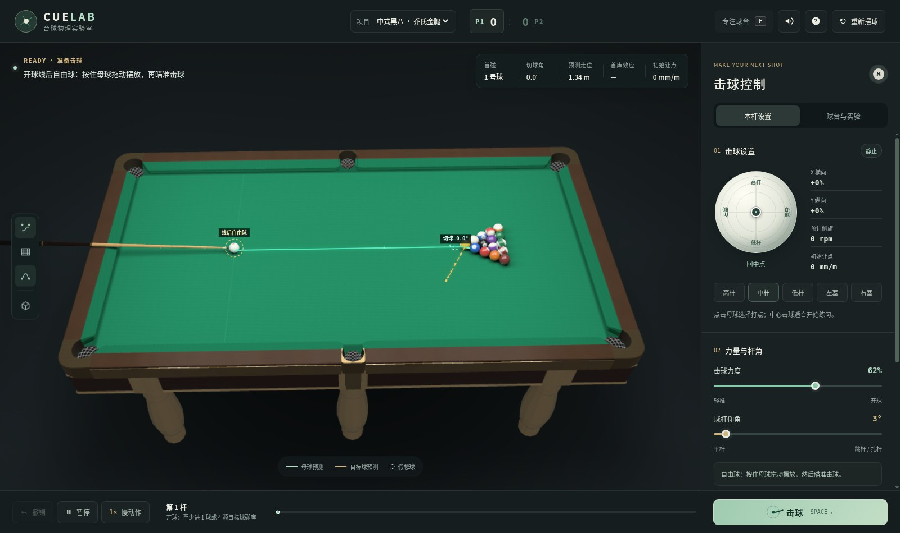
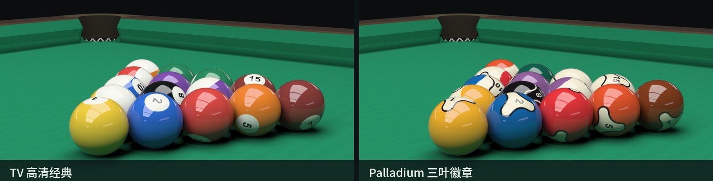
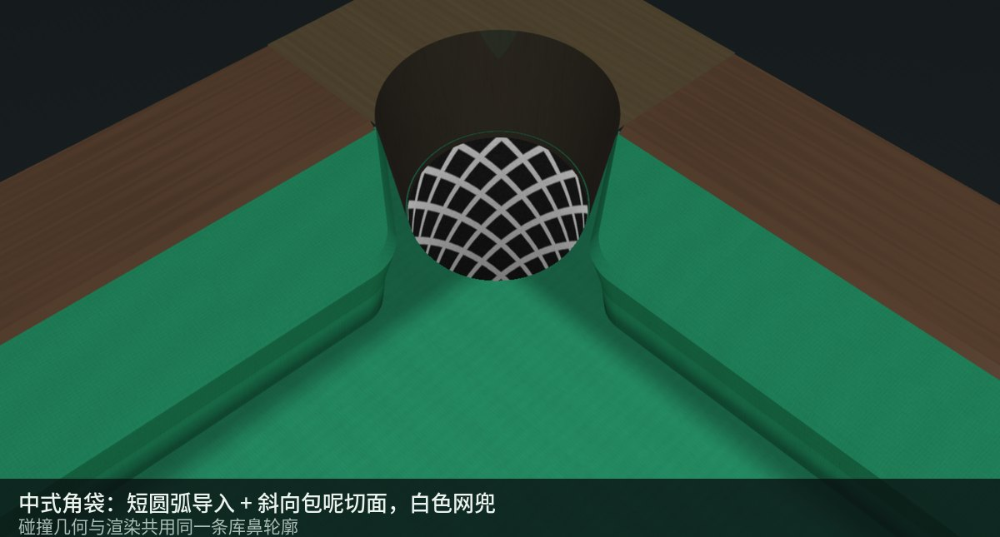
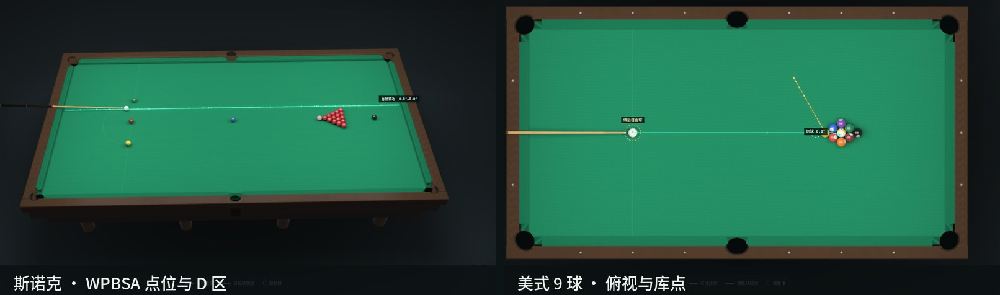
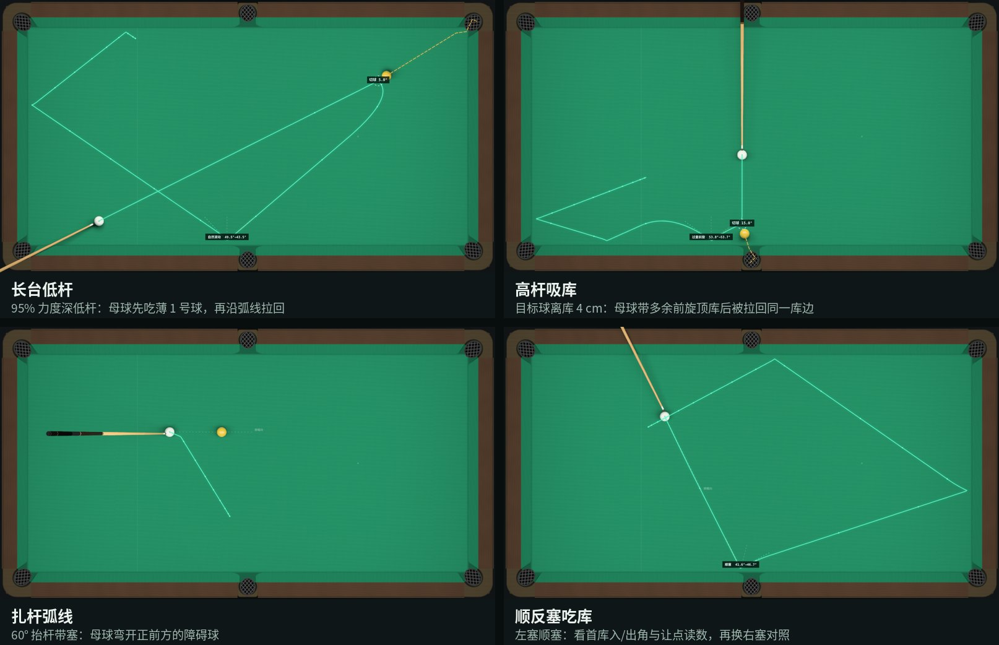
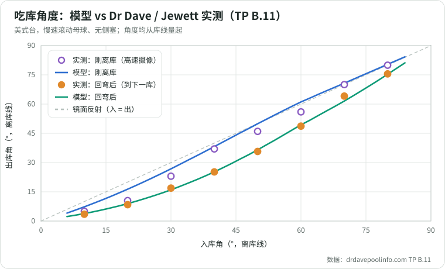
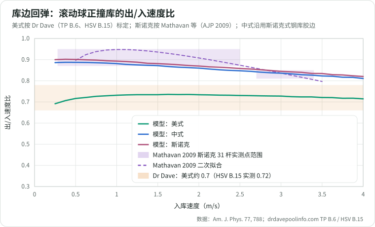
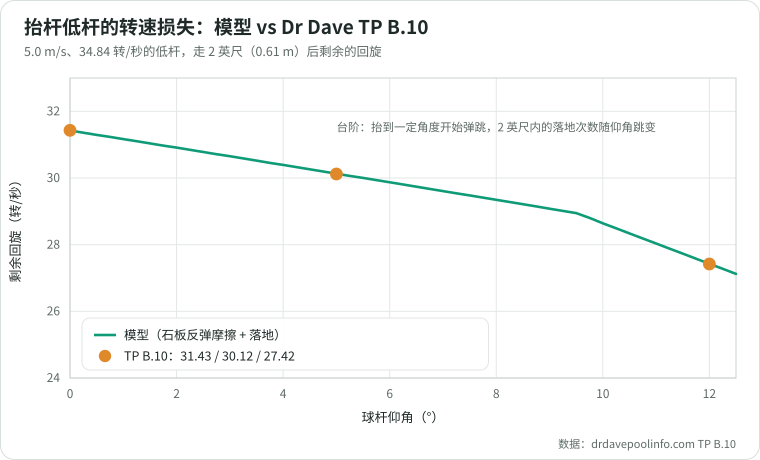
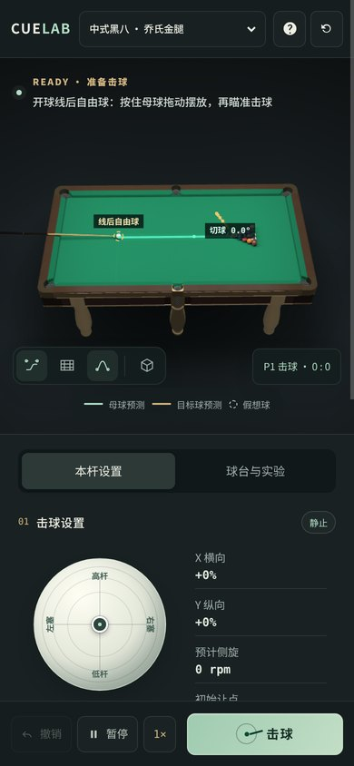

<div align="center">

# CueLab · 台球物理实验室

**在浏览器里研究杆法与走位：每一杆都由对照实测标定的物理引擎算出来**

   



</div>

CueLab 是一个无需后端、无需构建、无需联网的 WebGL 台球游戏与杆法学习工具。三维模型、球纹理、声音和教学辅助线都在浏览器本地生成。默认是中式黑八（乔氏金腿式赛事台），也可以切换美式 8 球、美式 9 球、斯诺克和自由练习。

它和一般台球游戏的区别在于物理：母球的滑动与滚动、加塞的偏移与回弯、吃库的反弹角与速度损失、抬杆的石板反弹，都用刚体方程逐毫秒积分；库边橡胶、台呢摩擦与击球模型对照 Dr Dave（Alciatore）、Bob Jewett、Mathavan 等人发表的实测数据标定，并写成了回归测试。辅助线显示的就是这套物理的数值预演，不是几何直线。

- **杆法**：高杆、低杆、定杆、左右塞、0–60° 抬杆扎杆；疵杆极限、squirt 让点、弧面皮头接触点都有模型
- **走位**：母球的滑动→滚动转换、分离角（90° / 30° 法则）、吃库回弯与速度损失，辅助线逐杆预演
- **吃库**：库边是会压缩的橡胶，入库的高低杆和侧塞会留在出库状态里；美式台出库角与实测误差约 1°
- **袋口**：中式短圆弧袋角、斯诺克圆弧袋角、WPA 斜切袋角，碰撞几何与渲染共用同一条轮廓

## 目录

- [快速开始](#快速开始)
- [画面一览](#画面一览)
- [杆法与走位实验](#杆法与走位实验)
- [物理对照实测](#物理对照实测)
- [界面与操作](#界面与操作)
- [功能清单](#功能清单)
- [物理模型](#物理模型)
- [研究与实现参考](#研究与实现参考)
- [开发与测试](#开发与测试)

## 快速开始

最简单的方法是直接双击 `index.html`。Chrome、Edge、Firefox 和 Safari 的较新版本均可运行；浏览器需要支持 WebGL 2，并开启硬件加速。

也可以使用仓库自带的零依赖静态服务器：

```bash
npm run serve
```

然后访问 `http://localhost:8080`。服务器只是为了方便开发，不参与游戏运行。

URL 参数可以直接分享一个练习场景：

```text
index.html?mode=snooker&tipx=0.45&power=0.8&elev=6&view=top&yaw=40&pitch=30&slow=20&skin=palladium&rack=7&shoot=1&t=2
```

它会载入杆法、相机角度、慢动作档位（`slow=4/20/50/100`）、球组外观和摆球种子（`rack`），`shoot=1&t=2` 把击球快进到第 2 秒。链接里的种子只固定链接本身摆出的球局，之后重新摆球恢复随机。

## 画面一览







- **球房灯箱光照**：唯一光源是台面上方 1 m 的矩形灯箱（国内球房常见的三块漫射面板加深色横档；斯诺克台四块），按面光源解析计算照度，库边、台角约为中心的 75–90%（WPA 要求台面各处 ≥520 lx、中心不明显偏亮）。每颗球和瞄准时的球杆都投下带本影的软阴影，台面下的柜体和球腿只受球房环境光。
- **球面反光**：酚醛树脂球为漫反射底色加 F0 = 0.05 的清漆镜面，按 Fresnel 反射视线方向实际看到的东西——灯箱窗格、被照亮的台呢（球下半部泛绿）、相邻的球和暗色球房。
- **两套球组**：高档 TV 球（转播友好色板、两枚对置号码章、六红点母球）；“Palladium 三叶徽章”按 Dynaspheres 产品摄影与转子标志重绘（三瓣徽章、条纹球宽象牙带加两极色帽、母球六枚转子标记）。
- **乔氏式台体**：库边无菱形库点（斯诺克台同样没有，只有美式台保留 18 个库点）、六条多面车削金腿、白色网兜袋、深色围板与香槟金压条。

## 杆法与走位实验



在「球台与实验」页选择场景。默认标准台呢、小头杆、中等皮头；更换器材会改变结果，场景不会偷偷重设器材，也不施加任何特殊力。打一杆后撤销，只改一个变量再打，就是一次对照实验。

- **长台低杆**：1.8 m 行程、95% 力度、深低杆，目标球入袋后母球回拉碰库；撤销并减到 80% 可对照途中后旋的损失（偏心击球分走出杆能量，长台回拉需要接近全力）。母球离库太近被迫抬杆时，石板反弹还会当场吃掉一部分低杆。
- **高杆吸库**：离库 4 cm 的球用 90% 力度大高杆切进中袋，母球带着多余前旋顶库、弹出十来厘米后回到同一库边。只有撞库时仍有大量过量前旋才会回吸，目标球离库稍远或力度不足就不会发生。
- **扎杆弧线**：60° 中等力度抬杆，绕开正前方的障碍球；预测线保留腾空高度，没有首碰就不画假想球。
- **齿轮抛掷**：30° 切球，从无塞开始逐渐增加外塞，对照抛掷减小、抵消及反向。齿轮条件取决于碰球瞬间的接触滑动，不是固定的 UI 打点。
- **顺反塞吃库**：左塞顺塞打一杆，撤销后改右塞；结束提示报告首库的入/出角与胶边压缩，HUD 同时给出让点读数。
- **贴库球**：母球与目标球都贴长库，观察沿库到圆弧袋角时是进袋、晃袋还是被圆角弹出。

慢动作五档（1×、1/4、1/20、1/50、1/100，物理步长同比例细化到 10 µs）可以逐帧看胶边压缩和滑动到滚动的转换；「保留真实轨迹」把实际走过的路线画成虚线，与下一杆的预测线对照。

## 物理对照实测

所有曲线都由当前代码算出（`node tools/validation-charts.js` 重新生成），实测数据点来自原始文献；同样的对照写在 `tests/reference-data.js` 里，每次 `npm test` 都会检查。

<p align="center"></p>

美式台慢速滚动母球的吃库角度。刚离开库边时，母球还带着指向库边的前旋；这股旋转在随后的滑行里把路线往库边方向拉弯，所以“回弯后”的角度才决定 K 球和翻袋落在哪里。回弯后出库角与 Jewett、Dr Dave 的实测均方根误差约 1°（修正库鼻摩擦前为 7.3°）。

<p align="center"></p>

库边弹性按台型分别标定：美式台对照 Dr Dave 的滚动入库 COR ≈ 0.7（HSV B.15 实测 0.72）；斯诺克对照 Mathavan 等高速摄像的 31 杆正撞（紫色阴影是论文图中实测点的大致范围，虚线是论文给出的二次拟合；模型落在实测点范围内，在 1–2 m/s 比拟合曲线低约 0.05）；中式台没有公开实测，按斯诺克式钢库胶条沿用斯诺克损耗（推断值，见[吃库与圆弧袋角](#吃库与圆弧袋角)）。

<p align="center"></p>

抬杆击球时，石板的反作用本身就是一次滑动摩擦：水平 / 5° / 12° 抬杆的低杆走 2 英尺后剩 31.43 / 30.13 / 27.43 转/秒，与 TP B.10 的 31.43 / 30.12 / 27.42 一致。

| 对照 | 实测 | 本模型 |
| --- | --- | --- |
| 吃库：TP B.11 慢速滚动球出库角（美式） | 刚离库 / 回弯后 | 均方根误差约 3.5° / 1° |
| 正撞库：HSV B.15（1000 帧高速摄像） | 滚入 e≈0.72、出库近定杆、滑行后约剩 52% 速度；定杆入库带前旋离库 | e≈0.73、出库 −0.17（近定杆）、剩 49%；定杆入 +0.22 前旋 |
| 定杆翻袋：TP B.28 | tan(入)/tan(出) ≈ 1.17–1.32 | 1.17–1.19 |
| 库边活性：WPA 检验（中心击球、平杆、较大力度） | 至少 4–4½ 个台长 | 8 / 10 m/s 出球约 4.0 / 4.4 个台长 |
| 斯诺克正撞：Mathavan 等 AJP 2009（31 杆） | 2.5 m/s 以下约 0.87–0.95，2.7–3.4 m/s 约 0.81–0.85 | 0.5 / 1.5 / 2 / 3 / 3.5 m/s：0.90 / 0.88 / 0.87 / 0.84 / 0.83 |
| 抬杆低杆：TP B.10 | 31.43 / 30.12 / 27.42 转/秒 | 31.43 / 30.13 / 27.43 |
| 侧旋衰减：TP B.2 原地转停 | 约 10 rad/s²，与转速无关 | 10.9 rad/s²，恒定 |
| 抬杆回弯：TP A.19 最终偏角 | 5° / 10° / 20° 抬杆解析值 | 相差约 7% 以内 |
| 碰撞抛掷：TP A.14（½ 球定杆，1 / 3 / 7 mph） | 4.7° / 3.6° / 1.7° | 4.84° / 3.56° / 1.70° |
| 分离角：TP A.5 / A.6（½ 球，含摩擦与非弹性） | 定杆 83.3°，滚动母球偏转 34.0° | 80–86° / 32.8–35.3°（慢→快） |

## 界面与操作



本杆设置集中放置打点、力度、杆角与学习辅助；「球台与实验」提供杆具、台呢、球组外观与固定球位实验。底部的击球、撤销、暂停和慢动作按钮保持可见，手机上也可直接操作。

- 鼠标或触控：移动瞄准，沿瞄准反方向拖动并松手击球；也可以调好参数后按空格。
- 母球打点支持点击、触摸，以及聚焦后的方向键微调，`Home` 回到中心。中杆不等于定杆，定不定得住取决于距离、速度和触球时的滑动状态。
- 疵杆风险、母球预计落袋或飞出台面、被库边或后方的球挡住而自动抬杆 / 上移打点，都会在面板里说明。暂停、摆球、等待非法开球选择或本局结束时，底部主按钮会给出对应的下一步。
- 自由球（开球、犯规后）：母球周围出现虚线圈时，按住母球即可拖动摆放（手机上允许手指略有偏差），按在别处仍是瞄准与出杆；按住母球时不会误出杆。开球及开球犯规后只能摆在开球线后。
- 手动摆球模式（`B`）：左键拖动母球与彩球任意布局，拖入袋口收进托盘，点托盘放回，一键清空台面，用于摆位与走位分析。
- CAD 式轨道相机：右键拖动旋转、滚轮缩放、双击右键复位，首次拖动从当前机位无跳变接管。
- 墨绿、比赛蓝、经典绿三种台面配色，以及球组、声音和辅助线偏好保存在浏览器本地；禁用存储时仍可正常运行。

| 按键 | 功能 |
| --- | --- |
| `W` `A` `S` `D` | 微调母球打点（上/左/下/右） |
| `Q` / `E` | 减小 / 增大出杆力度 |
| `Z` / `C` | 瞄准线向左 / 向右水平微调（加塞让点，0.55°/s） |
| `X` | 让点微调一键复位 |
| `Shift`（按住） | 微调速度 ×4 |
| `Space` | 击球（聚焦按钮、滑块等控件时保留原生操作） |
| `B` | 手动摆球 / 完成布局 |
| `F` | 专注球台 / 显示设置 |
| `G` | 开关预测线 |
| `M` | 慢动作档位循环 1×→1/4→1/20→1/50→1/100 |
| `R` | 重新摆球 |
| `Esc` | 暂停 / 继续 |
| 鼠标右键拖动 | 旋转视角（双击右键复位） |

## 功能清单

### 规则与摆球

- 中式黑八按中国台球协会《中式台球竞赛总则》（2017 修订）：开球线后自由球开球；开球须进球或至少 4 颗目标球碰库，否则由对手选择重新开球、令开球方重开（再犯判负）或接受台面自由球；开球进黑八放回置球点、开球方继续；开球后球局开放，先碰哪组并打进该组球才确定球组；无球入袋时击球后须有球碰库；犯规后对手获得全台自由球，母球未落袋时停在原处；目标球飞出台面犯规且不复位，黑八飞出判负。美式 8 球共用这套流程，开放球局按合法进球定组；9 球犯规同样给全台自由球。
- 摆球按台协要求彼此紧贴，并加入按种子生成的亚毫米级随机偏差。完全对称、等间隙的理想三角会像牛顿摆一样只把开球动量传给后排两角；每次摆球使用新种子，开球结果与实台一样各不相同。
- 台面标记按各规则机构：斯诺克开球线距底库 737 mm、D 半径 292 mm、黑球点距顶库 324 mm、粉球在蓝球与顶库中点、红球堆顶点紧贴粉球后方（WPBSA）；美式台开球线与置球点在 1/4 台长处（WPA），九球按 WPA 2025 把 9 号放在置球点、1 号在前端。
- 击球时贴着库边的目标球或母球，要先离开再回来才算“碰库”（台协 §13.2、WPA §2.7）。

### 球台与器材

- 中式台按可公开核实的乔氏 Q8 金腿式赛事台标定：2.54 × 1.26 m 内沿、57.15 mm 比赛球、钢库、圆弧袋角、85 mm 角袋与 86 mm 中袋（GB/T 22751-2008 中式球台：角袋 84、中袋 86 ± 1 mm）。
- 美式台按 WPA 器材规范：角袋 4.5 英寸、中袋 5.0 英寸，袋角斜切 142° / 104°；斯诺克为圆弧袋角。
- 小头杆（10.0 mm，低偏移）和大头杆（12.5 mm），软 / 中 / 硬三种皮头；前端有效质量、整杆质量、皮头摩擦与安全击点分别建模。快 / 标准 / 慢三种台呢，中式台呢有顺毛 / 逆毛的方向性阻力。
- 力度条最后约 20% 为开球区：100% 时母球约 9 m/s（实台大力开球约 8–11 m/s），80% 以下手感不变。
- 球杆按实际渲染的锥形杆体检测与库边、木扶手及母球后方球的净空：先把杆角抬到刚好越过（最多 45°），仍够不到所选击点时自动上移打点。贴库球因此打不出低杆，球杆也不会穿过库边。

### 物理引擎

- 1 kHz 固定步长刚体解算（预测线同频），对球—球与球—库重叠做线性碰撞时刻回退（TOI）；慢动作按同比例细化步长，1/100 档以 10 µs 步进。
- 球—台呢滑动摩擦、滑动到纯滚动的解析转换、滚动阻力；侧旋按恒定枢轴摩擦衰减。
- 球—球采用 Alciatore 速度相关摩擦 μ(v)，覆盖切球抛掷、齿轮外塞抵消抛掷与旋转转移；腾空碰撞联立三维法向、切向摩擦锥与只能向上支撑的石板反力；同一时刻的关联接触联立求解。
- 库边为会压缩的橡胶接触，按 min(69 µs, dt) 子网格跨步积分，输出压缩深度与接触时长；库鼻摩擦按首次接触的滑动方向作用（Han 2005）；腾空撞库时压缩沿倾斜法线计算，能量守恒。
- 与直库共切点、共法线的圆弧袋角；球越过袋沿后受重力下落，浅入袋仍可返回台面，球心低于石板才记进袋。
- 击球为刚性冲量模型（TP A.30）：偏心击球分走出杆能量，squirt 按 Cross（2008）前端有效质量公式；抬杆出杆计入石板反弹摩擦（TP B.10），石板恢复系数 0.6。

### 辅助与工具

- 基于同一物理内核的数值预演辅助线；假想球和切角来自预演中的实际首碰，立体碰撞不显示平面假想球。轨迹保留腾空高度，另有袋口走廊、原瞄向、初始让点、首库角度、速度、转速、滑差和机械能读数。
- 模态合成撞击声：酚醛球多部分音、库边低频闷响、皮头触击、疵杆刮擦与落袋撞胆声，按球位做立体声像。
- 性能：库边检测只处理靠边的球、袋口细分只检查袋口附近，物理步进比早期版本快约 2.8 倍且结果逐位不变；辅助线预演分帧推进（每帧约 6 ms）；静止的台面不重算也不重画；着色器用每帧生成的 5 cm 遮挡网格只对附近的球算阴影。硬件 WebGL 使用完整设备分辨率，软件渲染采用 80% 内部缓冲。

## 物理模型

内部坐标为 `x-z` 台面和竖直 `y` 轴。球的惯量使用实心球 `I = 2/5 mR²`。台呢接触点的滑动速度为：

```text
u = v + ω × (0, -R, 0)
```

滑动阶段用库仑摩擦同时更新线速度与角速度；步内解析计算滑差达到零的时刻，余下时间按纯滚动演化。检测到的碰撞按线性回退时刻排序，同步且共享球的接触以共同碰前状态组成冲量簇求解。腾空球使用三维球心法线、接触点速度和力矩，石板接触是只能推、不能拉的单边约束。

预测器克隆当前世界，以同样的 1 kHz 内核预演最多 12 秒，并分帧推进（首帧约 10 ms，之后每帧约 6 ms），开球的完整轨迹几帧内算完；算完之前读数带“≥”前缀，尚未发生的接触不会显示为“无接触”。改变杆法、器材、台呢或瞄准都会重算，HUD 与面板读数跟随实际击出的那一杆（包括自动抬杆与上移打点）。

默认中式黑八参数：

| 参数 | 默认值 |
| --- | ---: |
| 乔氏金腿式台面内沿 | 2.54 × 1.26 m |
| 半径 | 0.028575 m |
| 质量 | 0.1695 kg |
| 球/台呢滑动摩擦系数 | 0.20 |
| 滚动阻力等效系数 | 0.0095（标准预设） |
| 球/球恢复系数 | 0.95 |
| 球/球摩擦系数 μ(v) | 0.0100 + 0.108·e^(−1.088v) |
| 胶边迟滞 χ / 黏滞损耗 c | 0.055 s/m / 8.5 N·s/m（斯诺克式钢库胶边） |
| 滚动球正撞库法向速度比 | 0.5 / 1 / 2 / 3 m/s：约 0.89 / 0.88 / 0.86 / 0.84 |
| 胶边切向摩擦系数 | 0.20 |
| 角袋 / 中袋有效嘴宽 | 0.085 / 0.086 m |
| 公开库高 / 等效接触合力高度 | 0.042 / 0.037 m |
| Q8 公开石板厚度 | 0.046 m |

### 三种台的袋口规格

中式台沿用乔氏钢库圆弧袋角：角袋按赛事台在圆弧最窄处的 85 mm 紧口，中袋按 GB/T 22751-2008《台球桌》表 1 中式球台的 86 ± 1 mm（角袋 84 ± 1 mm）；台协竞赛总则本身不规定袋口宽度。美式台按 WPA 器材规范：角袋口 4.5 英寸、中袋口 5.0 英寸（袋口在两库鼻尖点之间量取），袋角为平面斜切 facing——角袋与库边成 142°、中袋成 104°，物理上使用胶囊线段碰撞体，因此贴库薄球在袋角上的挂库/吐库行为与实台一致。斯诺克使用圆弧袋角，角袋落口约 86 mm、中袋约 103 mm；WPBSA 官方规格以模板图纸为准，这里是模板量级的近似。

### 吃库与圆弧袋角

袋口模型区分“胶边嘴宽”和“石板开口”。美式角袋保留 32 mm 石板支撑区，中袋为 5 mm，处于 [WPA 官方器材规范](https://wpapool.com/wp-content/uploads/2024/01/RECOMMENDED-EQUIPMENT-SPECIFICATIONS.pdf) 的规定范围内。中式与斯诺克的石板支撑深度、椭圆开口及袋胆尺寸是本项目的近似参数，并非厂家模板复刻。袋壁采用耗能冲量与 12° 向下法线，袋沿使用球面与石板边缘的支撑接触；不模拟布料变形、皮革弹性及袋内多球堆积。

中式库口按参考图重建为六块连续包呢曲面，不再将独立圆头叠在直库两端：角袋的圆弧转过约 55° 后接相切斜面；中袋单独使用沿库 55 mm、进深 28 mm 的四分之一椭圆缓弧，将两侧收肩拉长、后部金属包口收窄，避免套用角袋的小圆头。包呢顶面从库鼻向扶手抬升，袋内折面连接石板袋沿。中袋碰撞求解椭圆最近点及其法线，与可见轮廓共用尺寸；不保留藏在胶边内的整圆碰撞体。半径、转角、截面和金属袋角外形是依据参考图的建模近似，不是厂家袋口模板实测值；85/86 mm 的最窄嘴宽及石板开口保持不变。

新接触的库边（尤其是圆弧袋角）按本步直线路径二分求出真实触及时刻，再从那里积分胶边压缩。旧做法按“穿透深度 ÷ 法向速度”线性回退，在圆弧袋角上会把快球退到胶边之外，接触随即以零作用力结束，快球因此穿过袋角进袋，出现“越大力袋口越宽”、1× 与慢动作结果不一致的问题。

球越过库边后若远离所有袋口，一旦越过扶手外沿或落到扶手上即判为飞出台面，发出独立的出台事件，不再被塞进最近的袋。

库边压缩接触以 `k = 1.5×10⁷ N·m⁻¹·⁵` 积分，力律 F = k·δ^1.5·(1 + χ·δ̇) + c·δ̇。只有 Hunt-Crossley 迟滞时，低速恢复系数趋近 1，轻碰、擦碰袋角和慢速 K 球都比实测弹得多；黏滞项 c 让这些接触保持耗能。库鼻摩擦使用与法线正交的两个切向轴，方向与预算在每个碰撞体首次接触时确定：沿初始滑动方向做库仑滑动，直到用完“恰好止住初始滑动”的冲量，且只在接触仍朝该方向滑动时作用，因此不会做正功。旧做法每个子步重新“粘住”，任何高杆、定杆、低杆正撞后都以同样的轻微回旋离库，沿库方向的速度也被多吃掉约 35%。

各台的标定数据与对照图见[物理对照实测](#物理对照实测)，并由 `tests/reference-data.js` 回归。

中式台没有任何公开的库边实测。中式胶条为梯形（斯诺克式 L 截面），钢库结构与北方胶条同斯诺克，因此沿用斯诺克的损耗参数（按球重折算）与美式球的库布摩擦 0.20；星牌所述“大力推杆长边 4 库半左右”的检验，本模型 8 m/s 约 5.0 个台长（碰短库 5 次）。这是由结构推断的标定，不是中式台实测。代价是中式、斯诺克翻袋比美式“短”（定杆翻袋比值约 1.41 / 1.36，美式 1.18），与 Dr Dave“库边越弹、翻袋越短”的规律一致，但幅度未经实台核对。斯诺克库鼻合力高度按 Mathavan 实测取 36 mm（≈1.4R）。

加塞吃库：正撞库时满塞（到库时转速比约 1.5）回弯后偏离约 28°（美式）。Dr Dave 引用的 Patrick Johnson 经验图是 1/3、2/3、满塞约偏 1、2、3 个库点；本模型在美式台同条件下约 0.6 / 1.3 / 1.7 个库点，即经验值的约六成，但与 Mathavan、Han 等已发表模型同量级或更大。顺塞离库更快、角度更长，反塞更慢、更短。

高杆吸库不能仅凭入库时有前旋判断。界面先区分“自然滚动”和“过量前旋”，实际观测到母球离库、反向且再次接触同一库段，期间未碰其他球或库，才显示“回吸同库”。一键高杆实验先厚切目标球入袋，母球减速后保留较多前旋，再完成该过程；直接把自然滚动球打向库边不是同一种条件。

球心投影进入石板开口后，继续按重力、袋沿支撑及袋壁反弹演化，球心低于石板才计入进袋。袋口附近局部细化到 0.1 ms，保留实际球径，以深度遮挡呈现下落。角袋短圆弧与中袋椭圆缓弯使用各自的相切侧壁，不共用整圆碰撞体。

42 mm 是中式赛事级器材草案中“胶边上表面到台面”的库高，不等于球与整块胶条的唯一受力点。物理模型将形变接触带压缩为 37 mm 等效合力高度（球径的 65%，WPA 要求美式为 62.5–64.5%），避免把 42 mm 上沿当成尖锐点冲量。这个合力高度是可调标定值；品牌胶条截面、配方、安装预压、温湿度和磨损数据未公开。

袋角形状：唯一可量化的圆弧袋参考是 WPBSA 2005/6 模板的非官方复绘（CEBP）——斯诺克角袋袋角为 3″→4.5″ 的复合大圆弧，起弧点距另一库鼻线约 90 mm，石板落口弧（半径 3.5″）在最窄处之前约 22 mm；中袋落口几乎与库鼻线齐平。中式袋口没有公开模板，星牌说明“弯角宽了会吐球”，乔氏以“响袋不吐球”为验收，本项目保留依参考图建模的短圆弧袋角，没有照搬斯诺克模板。按模板比例试算的原型会让慢球更容易被“引”进袋、快球窗口略小，但缺少中式袋口实测，未作为默认几何。

### 球杆、皮头与加塞让点

价格不会直接进入方程。所谓“3000–10000 元高性价比比赛杆”在此表示杆身笔直、能量传递稳定、无随机制造误差，并用可测的质量参数表达：

| 杆型 | 皮头 | 整杆质量 | 前端有效质量 | 特性 |
| --- | ---: | ---: | ---: | --- |
| 小头杆 | 10.0 mm | 515 g | 5.2 g | 中式低偏移木前节，默认 |
| 大头杆 | 12.5 mm | 535 g | 6.4 g | 美式大头枫木前节，偏移略大、容错稍高 |

软/中/硬皮头分别使用不同的皮头—球摩擦、安全偏心击点和极小的能量/旋转传递差异。软件不会宣称“软皮头凭空产生更多旋转”：同一实际击点的旋转主要由碰撞几何决定，皮头抓力主要决定不滑杆的安全边界。

加塞后的初始偏移（squirt）参考 Cross（2008）/Alciatore TP A-31 的前端有效质量冲量公式：`tan α = (5/2)(b/R)·c / (1 + (5/2)c² + M/mₑ)`，其中 b 为弧面皮头的实际接触偏移（杆轴瞄点 h 落在 b = h·R/(R+ρ)）、c 为接触余弦、M 为球质量、mₑ 为前端有效质量；最大打点时小头杆约 1.8°、大头杆约 2.2°，与 Dr Dave 实测的低偏移 1.8°、普通前节 2.5° 同量级。器材参数不应理解为厂家实测。公式保留前端质量与近似速度无关性，不显式求解杆身振动。

偏心击球按刚性冲量（Alciatore TP A-30）：同样的出杆速度，球速降为中心击球的 (1 + m_b/m_s)/(1 + m_b/m_s + 2.5(b/R)²)（最大打点约 0.66），旋转 ω = 2.5·v·b/R²，并按 TP B-7 扣除 squirt 缩短的侧向力臂。因此最大转速比 ωR/v 约 1.1–1.3（Dr Dave 实测典型 1.25、极限 1.37），打点越靠边、出杆越需要加力；旧版的经验传递因子曾让最大加塞达到 1.44、且偏心球的能量反而多于中心击球。

疵杆极限来自两个物理边界的较小值：巧克粉摩擦锥（击点偏移 b 处接触法线倾斜 asin(b/R)，抓握要求 b/R ≤ μ/√(1+μ²)，软/中/硬皮头为 0.58/0.56/0.53）与皮头形状/分离边界（TP A-30 量级，约 0.50–0.55 R）。合成极限约 0.50–0.54 R，与 Dr Dave 反复实测的“约半个球半径、对巧克粉品牌不敏感”一致。抬杆会把侧旋轴倾斜，球—台呢滑差随后把路线弯回（swerve），5°/10°/20° 抬杆的最终偏角与 Dr Dave TP A.19 的解析值相差约 7% 以内。抬杆还把冲量的竖直分量压进石板，石板的反作用是一次滑动摩擦（TP B.10）：水平速度为 v(cosθ − μ(1+e)sinθ)，后旋减少 (5/2R)·μ(1+e)·v·sinθ。5.0 m/s、34.84 转/秒的低杆走 2 英尺后剩 31.43 / 30.13 / 27.43 转/秒（水平 / 5° / 12°），与 TP B.10 的 31.43 / 30.12 / 27.42 一致；贴近库边被迫抬杆时，长台低杆会明显变短。面板的 `mm/m` 是只针对初始偏移的让点基准，绿色数值路线则包含随距离、速度、杆角和台呢变化的完整回弯，不能把一个固定让点套到所有球距。

### 模型边界

- 库边采用点接触压缩模型，没有求解胶条截面形变、剪切储能或石板柔度；库鼻摩擦沿用 Han 的首触方向规则，定杆正撞离库的前旋（+0.22）弱于 HSV B.15 读出的约 +0.76，满塞吃库的偏转约为经验图的六成。弹库小跳按经验返还部分压入冲量，并限制在该次接触已损失的机械能以内。库边接触时长与压缩量（0.5–8 m/s 正撞约 2.6–1.4 ms、0.4–3.4 mm）未找到实测数据，只是刚度取值的结果。
- 普通同高度落地球的碰撞仍采用“石板承受竖直反力、竖向摩擦只交换旋转”的平面近似；腾空球及不同半径球使用三维冲量分支。没有求解球体压缩期间的连续形变。
- 扎杆的落地后曲线已与滑动阶段解析解对照，起跳与落地的石板恢复系数取 TP B.10 的 0.6（Dr Dave 给出的范围 0.5–0.7），皮头传递效率尚未按实台录像标定；支持 0–60°，不宣称覆盖近竖直的全部扎杆。腾空碰库的接触高度在一次短接触内近似固定。
- TOI 是检测到步末重叠后的线性回退，不是完整连续碰撞检测；极端高速掠碰、重力下的触碰/落地时刻及多接触交错仍有有限步长误差。通过步长收敛、能量和动量回归约束误差，不承诺所有场景零误差。
- 皮头形变、杆身振型、球台微倾、湿度、污渍和袋内多球堆积未连续建模。回归测试验证方程和案例，不替代实台标定。

乔氏、Q8 及相关名称属于其权利人；本项目是独立教育模拟，没有厂商背书。复刻某张实台仍需测量滚距、三库回弹、袋口模板、转速及球杆偏移。

## 研究与实现参考

以下来源用于核对参数、运动状态和碰撞模型；本项目的 JavaScript、WebGL 着色器、界面与确定性程序化材质均为独立实现，没有复制第三方网页游戏代码或素材。

- Evan Kiefl, [Pooltool: A Python package for realistic billiards simulation](https://doi.org/10.21105/joss.07301), Journal of Open Source Software, 2024；[Pooltool 源码](https://github.com/ekiefl/pooltool)采用 Apache-2.0。
- Pooltool 的 [`BallParams` 参数定义](https://pooltool.readthedocs.io/en/v0.4.4/_modules/pooltool/objects/ball/params.html)，用于交叉核对球半径、质量、摩擦与恢复系数的量级。
- Evan Kiefl, [The physics of pool/billiards](https://ekiefl.github.io/2020/04/24/pooltool-theory/)，系统整理滑动、滚动、旋转、球碰撞和库边碰撞状态。
- S. Mathavan, M. R. Jackson, R. M. Parkin, [A theoretical analysis of billiard ball dynamics under cushion impacts](https://drdavepoolinfo.com/physics_articles/Mathavan_IMechE_2010.pdf), Proceedings of the IMechE Part C, 2010。Eq. 1–4 用于核对库鼻切向受力、力矩和石板载荷，斯诺克库布摩擦 μw = 0.14 取自其拟合；论文的材料恢复系数与含摩擦、旋转的出入速度比不是同一参数，本项目并非逐参数复刻该实验。
- S. Mathavan, M. R. Jackson, R. M. Parkin, [Application of high-speed imaging to determine the dynamics of billiards](https://drdavepoolinfo.com/physics_articles/ajp_09_hsv_article.pdf), Am. J. Phys. 77, 788 (2009)——斯诺克滚动球正撞库的出入速度比（31 杆，0.28–3.5 m/s）、36 mm 库鼻高度、台呢滑动/滚动阻力，用于斯诺克与中式库边损耗标定。
- S. Mathavan, M. R. Jackson, R. M. Parkin, [Numerical simulations of the frictional collisions of solid balls on a rough surface](https://doi.org/10.1007/s12283-014-0158-y), Sports Engineering, 2014。
- 中国台球协会，[中式台球竞赛总则（2017 修订）](https://cbsa.cssf.net.cn/annoucement/2017/0120/142126.html)，用于核对 2540 × 1270 mm 规则内沿、57.15 mm 球径、球重、摆球要求（彼此紧贴）、开球线 635 mm、合法开球、开球进黑八、开放球局、碰库要求与自由球规则。该总则不含袋口宽度条文。
- GB/T 22751-2008《台球桌》表 1 中式球台，用于核对 42 ± 0.5 mm 库高（胶边上表面到台面）与角袋 84、中袋 86 ± 1 mm 的袋口规格。
- 乔氏官方品牌页，[乔氏金腿公开结构](https://www.joy147.com/gsjj)，用于确认钢库、英国北方胶条、机械模压袋口与青石板结构；[Q8 金腿公开产品参数](https://www.joybilliard.com/billiards-table/golden-leg-billiards-table.html)用于核对 2.54 × 1.26 m 内沿、85 mm 袋口、8848 台呢、龙脊胶边与 46 mm 石板；[政府采购 Q8 参数表](https://zcy-gov-open-doc.oss-cn-north-2-gov-1.aliyuncs.com/1072PT/undefined/439900/10009011833/20253/bdb1ca9c-47c5-46be-856a-2a62ded72b61.pdf)用于交叉核对钢库、机械模压袋口和石板下限。
- [《中式台球 合金台球桌》2024 征求意见稿](https://www.ttbz.org.cn/upload/file/20241226/6387081313691921169640017.pdf)，用于核对 42 mm 库高、86 mm 中袋标注、57.15–57.25 mm 球径与 167–172 g 赛事球量级。它是征求意见稿，不被当作已生效强制标准。
- H. Kim, [Motions of a Billiard Ball After a Cue Stroke](https://doi.org/10.3938/NPSM.72.208), 2022；R. Cross, [Cue and ball deflection (or “squirt”) in billiards](https://doi.org/10.1119/1.2825392), 2008（[作者预印本](https://www.physics.usyd.edu.au/~cross/PUBLICATIONS/39.%20squirt.pdf)）。用于建立前端有效质量、皮头摩擦、碰撞效率和初始偏移之间的关系，以及横波传播时序对“无需显式模拟前节弯曲”的论证。
- David Alciatore, [Pool and Billiards Technical Proofs](https://billiards.colostate.edu/technical_proofs/)：[TP A-14](https://drdavepoolinfo.com/technical_proofs/new/TP_A-14.pdf)（球—球摩擦 μ(v) 拟合与摩擦锥 throw 推导）、[TP A-30](https://drdavepoolinfo.com/technical_proofs/new/TP_A-30.pdf)（杆—球动量传递、皮头恢复系数 0.73、分离边界）、[TP A-31](https://drdavepoolinfo.com/technical_proofs/new/TP_A-31.pdf)（前端有效质量 squirt 公式）；[实测疵杆极限约 0.5R](https://drdavepoolinfo.com/faq/sidespin/maximum/) 与[前端质量为 squirt 主因的论证](https://drdavepoolinfo.com/faq/squirt/endmass/)。
- W. Leckie, M. Greenspan, [An Event-Based Pool Physics Simulator](https://doi.org/10.1007/11922155_19), LNCS 2006——事件驱动台球模拟（poolfiz/FastFiz/Pooltool 一脉）的奠基论文，作为固定步长 + TOI 路线的对照。
- Dr. Dave 的[长台强低杆](https://drdavepoolinfo.com/faq/draw/power/)、[齿轮外塞](https://drdavepoolinfo.com/faq/sidespin/outside-gearing/)、[近库高杆回吸示例](https://drdavepoolinfo.com/bd_articles/2019/april19.pdf)与[扎杆原理和案例](https://drdavepoolinfo.com/bd_articles/2011/april11.pdf)，用于确定实验条件与应验证的现象，而非拟合单条动画轨迹。
- I. Han, [Dynamics in carom and three cushion billiards](https://doi.org/10.1007/BF02919180), J. Mech. Sci. Technol., 2005——球台摩擦与库边冲量模型及其速度相关恢复系数（Eq 26）；库鼻摩擦“按首触滑动方向、以止滑冲量为上限”的规则取自该模型（经 pooltool 勘误的 `han_2005` 实现）。
- Dr. Dave 与 Bob Jewett 的库边实测：[TP B.11](https://drdavepoolinfo.com/technical_proofs/new/TP_B-11.pdf)（慢速滚动球的刚离库与回弯后出库角）、[HSV B.15](https://drdavepoolinfo.com/high-speed-video/hsv-b-15/)（正撞库滚入/定杆/低杆的出入速度比与出库旋转）、[TP B.6](https://drdavepoolinfo.com/technical_proofs/new/TP_B-6.pdf)（滚动入库 COR 0.7、每库行程）、[TP B.28](https://drdavepoolinfo.com/technical_proofs/new/TP_B-28.pdf)（滑行翻袋比值）与[翻袋/K 球影响因素](https://drdavepoolinfo.com/faq/bank-kick/effects/)（顺反塞速度与角度、Patrick Johnson 加塞库点图）；[TP B.10](https://drdavepoolinfo.com/technical_proofs/new/TP_B-10.pdf)（抬杆低杆的石板反弹摩擦与转速损失）、[TP B.2](https://drdavepoolinfo.com/technical_proofs/new/TP_B-2.pdf)（侧旋原地转停约 10 rad/s²）、[TP A.19](https://drdavepoolinfo.com/technical_proofs/new/TP_A-19.pdf)（抬杆回弯的最终偏角）。
- [WPA 器材规范](https://wpapool.com/wp-content/uploads/2024/01/RECOMMENDED-EQUIPMENT-SPECIFICATIONS.pdf)第 7–8 节：库鼻高度为球径的 62.5–64.5%、库边活性检验（平杆中心击球至少 4–4½ 个台长）。
- WPBSA 2005/6 斯诺克袋口模板的非官方复绘（CEBP，经 rulesofsnooker.ca 存档）与 [T/CASME《中式台球 合金台球桌》征求意见稿](https://www.ttbz.org.cn/upload/file/20241226/6387081313691921169640017.pdf)（胶条硬度 46 Shore A、回弹率 86%、竞赛级回弹不低于 4 库），用于袋角形状与库边活性的对照。
- K. H. Hunt, F. R. E. Crossley, [Coefficient of Restitution Interpreted as Damping in Vibroimpact](https://doi.org/10.1115/1.3423596), J. Applied Mechanics, 1975——库边压缩-阻尼力律的出处。
- R. Shepard, [Everything you always wanted to know about cue ball squirt](https://drdavepoolinfo.com/physics_articles/Shepard_squirt.pdf), 2001——质量比与偏移/枢轴长度对照表，用于核对 squirt 量级。
- [tailuge/billiards](https://github.com/tailuge/billiards)——采用 Mathavan 2010 库边模型的开源 WebGL 实现，作为同类工程决策（如放弃 Han e(v) 采用常数恢复）的对照。
- [Dynaspheres Palladium 产品页](https://dynaspheres.cn/pool_balls/pool-palladium/)——“Palladium 三叶徽章”球组外观的视觉参考（配色与徽章、条纹、母球标记设计从官方产品摄影采样重绘）；Dynaspheres 及 Palladium 名称属于其权利人，本项目仅为独立的程序化致敬外观。

## 开发与测试

运行无需安装任何包：

```bash
npm test
```

`tests/physics-advanced.js` 验证三维碰撞的误撞/漏撞反例、闭式冲量、线/角动量、石板单边约束、同步碰撞对称性、600 组固定种子三维压力测试、库鼻正交切向受力、324 组碰库能量检查、90 杆随机击球（含腾空撞库）的能量不增、长台低杆强/弱与抬杆对照、16 组解析回弯，以及与 UI 共用球位的低杆进球回库、高杆进球回吸、扎杆绕障碍测试（1 ms / 0.1 ms 两档）。

`tests/pocket-regression.js` 覆盖三种台型 × 六个袋口 × 四档进袋速度共 72 组连续落袋检查，并验证袋沿支撑、浅入袋返回、腾空越袋、重力运动、进袋前后动量连续、一次进袋事件、落袋中的克隆与撤销、慢动作收敛、接触能量、低速滑转过渡及新增网格的面朝向；另有 369 次袋角入袋检查，要求没有零作用力的碰库接触、1× 与慢动作的有效袋口一致、大力球的袋口不比轻推时宽。

`tests/reference-data.js` 直接对照已发表的实测：TP B.11 滚动球出库角（回弯后均方根误差 < 2°）、HSV B.15 正撞库（滚入近定杆出库、定杆入库带前旋、滑行后约剩一半速度）、TP B.28 定杆翻袋比值、顺/反塞离库速度与角度次序、Mathavan 斯诺克正撞 COR、TP B.10 抬杆低杆的转速损失，以及 TP B.2 侧旋衰减与转速无关。

`tests/chinese-pocket-geometry.js` 另覆盖 312 个可见库鼻点与碰撞法线的一致性、12 个圆弧—袋内侧壁相切连接、24 组侧壁轻/重杆回弹与净耗能、角袋/中袋轮廓差异、六个金属袋角接缝、网格法线与退化面、克隆隔离，以及其他台型不受中式袋口改动影响。

测试覆盖五种摆球的初始穿透、紧贴且非理想点阵的摆球、可复现的摆球种子、满力开球必须打散并合法、跳球飞出台面判出台而非落袋、预测轨迹数值稳定性、滑动到滚动、紧袋落袋、乔氏式袋口几何（含中袋 86 mm 走廊捕获与贴库穿越）、12 个直库—圆弧切点的法线连续性、六袋对称直入、所有直库与袋角的贴球静止稳定性、大小头杆偏移差、皮头安全击点、疵杆极限落在实测 ~0.5R 边界（软皮头略宽于硬皮头）、顺/反塞库角、高/低杆库速、碰库能量审计、库边压缩接触（回弹系数随速度下降、压缩深度与接触时长量级、大力正撞弹库小跳）、库边接触的步长不变性（同一旋转吃库在 600 Hz 与 100 kHz 网格下速度/回弹/压缩一致，且细网格下接触跨步持续）、抬杆回弯，以及 Cross 让点量级与速度无关性、左右塞 throw 方向、轻杆/大力 throw 对比、定杆/滚动 throw 对比、CIT 切角驼峰曲线、齿轮外塞零投掷、黏着/滑移交界峰值、超齿轮量反向、内塞降 throw、高速薄切法线精度、顺旋反向传递、球—球碰撞能量审计和抬杆水平分速。

主要文件：

```text
index.html          单页结构与全部控制面板
styles.css          响应式视觉系统
js/math.js          向量、矩阵、四元数
js/physics.js       物理世界、摆球、预测器
js/drills.js        UI 与测试共用的六组固定球位
js/renderer.js      WebGL 2、灯箱面光源光照/阴影/反射（按材质编译）与离线程序化材质
js/app.js           输入、规则、辅助线、声音与 UI
tools/serve.js      零依赖静态服务器
tools/validation-charts.js  由当前模型重新生成 docs/images/*.svg 对照图
```

可选浏览器回归需在开发环境另行安装 Playwright 及 Chromium，不影响应用离线运行或 `npm test`：先启动 `npm run serve`，再运行 `npm run test:browser`。如使用已有安装，可通过 `CUELAB_PLAYWRIGHT_PATH` 指定 Playwright 模块路径、`CUELAB_CHROME_PATH` 指定浏览器路径、`CUELAB_TEST_URL` 指定测试服务地址。套件覆盖键盘/触控、设置持久化、暂停/撤销、五种模式、六个场景的实际击球和预测辅助，中式黑八规则（开球进黑八复位、非法开球选择、自由球拖动摆放、无碰库犯规、母球飞出台面、贴库杆角与打点限制），以及 320 / 390 / 768 px 布局；截图保存在系统临时目录。

改动物理后可以运行 `node tools/validation-charts.js` 重新生成 README 中的对照图。
